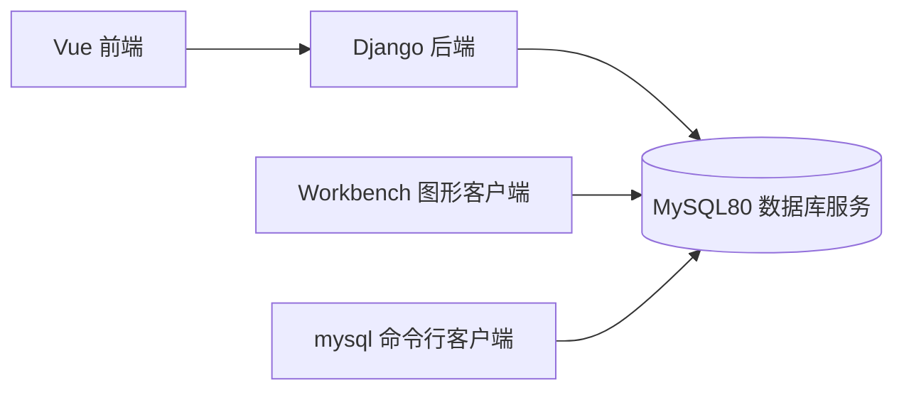

# 本机 MySQL 启动与使用指南

> 范围更新：2026-10-26 用户决定保留 CRSM 原纯前端架构。CRSM 当前完善目标使用 IndexedDB，不需要启动或配置 MySQL；本指南保留作本机 MySQL 的独立学习说明。

核对日期：2026-10-26。适用环境：本机 Windows、MySQL Community Server 8.0.45、服务 `MySQL80`。

本文中的本机信息来自服务与配置检查，操作示例尚未执行。本次没有启动服务、登录数据库、创建账号或修改现有数据；当前 Codex 终端没有管理员权限，也没有取得数据库登录凭据。

## 1. 你已经安装了什么

| 对象 | 本机实际情况 | 用途 |
| --- | --- | --- |
| MySQL Server | `D:\MySQL\MySQL Server 8.0`，程序版本 8.0.45 | 真正运行数据库、存储数据和接受 SQL 的服务 |
| Windows 服务 | `MySQL80`；检查时 Stopped，启动方式 Manual | 控制 Server 启动与停止 |
| SQL 端口 | 配置为 `3306` | Workbench、mysql 客户端和后续 Django 连接此端口 |
| 数据目录 | `D:\MySQL\MySQL Server 8.0\Data` | 服务管理的数据库文件；通过 SQL 管理其中的数据 |
| 配置文件 | `D:\MySQL\MySQL Server 8.0\my.ini` | 当前服务命令明确使用的配置文件 |
| 命令行客户端 | `D:\MySQL\MySQL Server 8.0\bin\mysql.exe` | 终端登录数据库、执行 SQL |
| Workbench | `D:\MySQL\MySQL Workbench 8.0\MySQLWorkbench.exe` | 图形化连接、查看数据库和执行 SQL |
| 其他已安装工具 | MySQL Shell、Router、Documentation | Shell 是另一种客户端；本项目初期不需要配置 Router |

当前配置还包括 `InnoDB` 默认存储引擎、严格 SQL 模式、`lower_case_table_names=1`，以及 X Protocol 端口 `33060`。本指南的普通 SQL 连接使用 **3306**。

当前终端未找到 PATH 中的 `mysql` 命令，但客户端文件实际存在。使用下文完整路径即可，不必先修改系统 PATH。

## 2. 先理解几个区别

**服务运行**与**客户端连接**是两件事。启动 MySQL80 后，Workbench、命令行和 Django 才能连接。打开 Workbench 本身不等于已经启动数据库；关闭 Workbench 或执行 `exit;` 只结束客户端连接，不会自动停止 MySQL 服务。

MySQL 账号与 Windows 账号分开。Windows 管理员权限用于启停系统服务；MySQL 的 root/业务账号及密码用于登录数据库。以管理员身份打开终端不能替代正确的 MySQL 密码。[官方服务与账号说明](https://dev.mysql.com/doc/refman/8.0/en/windows-start-service.html)



现在 Django 框架已经装在 `D:\CRSM\backend\.venv`，CRSM 业务后端还需要后续开发和数据库配置；启动 MySQL 不会自动启动 Django。

## 3. 启动 MySQL：推荐管理员 PowerShell

在 Windows 开始菜单搜索 PowerShell 或终端，右键选择“以管理员身份运行”，接受 Windows 提示后执行：

```powershell
Start-Service -Name MySQL80
Get-Service -Name MySQL80
```

预期看到 `Status` 为 `Running`。如果已经是 Running，直接进入连接步骤即可。

可再检查端口：

```powershell
Test-NetConnection -ComputerName 127.0.0.1 -Port 3306
```

`TcpTestSucceeded : True` 只证明端口可连接；随后成功登录并执行 `SELECT VERSION();` 才能确认数据库身份和认证。

本机服务已经注册，启动时不需要再次执行安装服务或初始化数据目录的命令。

## 4. 图形化启动与可选开机自启

不想使用命令行时：

1. 按 `Win + R`，输入 `services.msc`，回车。
2. 找到 **MySQL80**，双击进入属性。
3. 点击“启动”，使服务状态变为“正在运行”；有权限提示时使用管理员操作。
4. 保持“手动”则每次需要时启动；改为“自动”则随系统启动。

也可以在管理员 PowerShell 中设置开机自启：

```powershell
Set-Service -Name MySQL80 -StartupType Automatic
```

这只修改启动方式，当前未运行时仍需 `Start-Service`。恢复按需启动：

```powershell
Set-Service -Name MySQL80 -StartupType Manual
```

关闭数据库会中断后端连接；结束使用且没有运行任务时，可在管理员 PowerShell 停止：

```powershell
Stop-Service -Name MySQL80
```

## 5. 用 Workbench 连接：适合日常查看

先完成服务启动，再从开始菜单打开 MySQL Workbench，或在普通 PowerShell 执行：

```powershell
& 'D:\MySQL\MySQL Workbench 8.0\MySQLWorkbench.exe'
```

在首页 **MySQL Connections** 旁点击 `+`，创建连接：

| 字段 | 本机填写建议 |
| --- | --- |
| Connection Name | `Local MySQL80`，只是便于自己辨认的名字 |
| Connection Method | `Standard (TCP/IP)` |
| Hostname | `127.0.0.1` |
| Port | `3306` |
| Username | `root`，或安装时实际配置的管理员账号 |
| Password | 连接时在本机输入该 MySQL 账号密码 |
| Default Schema | 第一次可以留空，CRSM 数据库建好后可选 `crsm` |

点击 **Test Connection**；成功后保存并双击连接卡片。创建连接的过程和字段见 [Workbench 官方教程](https://dev.mysql.com/doc/workbench/en/wb-getting-started-tutorial-create-connection.html)。

进入 SQL 编辑器后：左侧 **SCHEMAS** 是数据库列表；展开库的 **Tables** 查看表；SQL 标签页可以执行下文查询。执行前确认当前选中的库和语句，避免把学习操作放入不相关数据库。

## 6. 用命令行登录

普通 PowerShell 即可；只有启动服务通常需要管理员终端：

```powershell
& 'D:\MySQL\MySQL Server 8.0\bin\mysql.exe' --host=127.0.0.1 --port=3306 --user=root --password
```

看到 `Enter password:` 后输入安装时设置的 MySQL root 密码并回车，输入时通常不显示字符。密码在本机输入即可，不要粘贴到聊天中或写进共享命令。

登录成功后出现 `mysql>` 提示符。此时输入 **SQL**，不再输入 PowerShell 的 `Start-Service` 命令。SQL 一般以分号结束；出现 `->` 通常表示语句还没写完，可以补齐语句或用 `\c` 取消本次输入。[mysql 客户端官方说明](https://dev.mysql.com/doc/refman/8.0/en/mysql.html)

退出连接：

```sql
exit;
```

## 7. 登录后先做这些只读检查

在 Workbench SQL 编辑器或 `mysql>` 中执行：

```sql
SELECT VERSION();
SELECT @@port, @@default_storage_engine, @@character_set_server;
SELECT USER(), CURRENT_USER();
SHOW DATABASES;
```

依次确认：实际服务版本、端口/引擎/默认字符集、连接身份与实际匹配账号、当前账号能看到的数据库。

`mysql`、`information_schema`、`performance_schema`、`sys` 是系统相关数据库；CRSM 使用独立的业务数据库。没有连接登录前，不能从“程序已经安装”推断 `crsm` 库或其表已经存在。

## 8. 为 CRSM 准备数据库和专用账号

以下是后续开发准备步骤，需要已登录且有相应权限的 MySQL 管理员账号执行。本次未代为执行。

先查看 `SHOW DATABASES;` 的结果。首次创建项目库可以使用：

```sql
CREATE DATABASE IF NOT EXISTS crsm
  CHARACTER SET utf8mb4
  COLLATE utf8mb4_0900_ai_ci;

USE crsm;
SELECT DATABASE();
SHOW TABLES;
```

`IF NOT EXISTS` 不会改变已有库的字符集。首次建库后的表列表为空是正常状态，后续应由 Django migrations 创建真实业务表。

建议为本机开发单独建账号，以下密码是**占位文本，执行前必须替换为自己设置的密码**。用户名和主机组合如果已经存在，应先核对，不重复创建或盲目改密码：

```sql
CREATE USER 'crsm_app'@'127.0.0.1'
  IDENTIFIED BY 'REPLACE_WITH_YOUR_LOCAL_PASSWORD';

GRANT ALL PRIVILEGES ON crsm.* TO 'crsm_app'@'127.0.0.1';

SHOW GRANTS FOR 'crsm_app'@'127.0.0.1';
```

这里给开发账号 `crsm` 库内权限，包含迁移需要的建表/改表能力；没有给全局管理权限或转授权能力。后续测试使用的独立数据库应另设授权，生产运行账号也可进一步收紧权限。使用 CREATE USER/GRANT 后不需要额外执行 FLUSH PRIVILEGES。[官方账号与授权说明](https://dev.mysql.com/doc/refman/8.0/en/creating-accounts.html)

另开普通 PowerShell 验证这个业务账号：

```powershell
& 'D:\MySQL\MySQL Server 8.0\bin\mysql.exe' --host=127.0.0.1 --port=3306 --user=crsm_app --password crsm
```

如果数据库或账号已经是其他名称，也可以沿用实际配置；不要为了匹配示例删除原有数据。

## 9. 后续 Django 如何连接

建议交给后端配置的参数为：

```dotenv
DB_HOST=127.0.0.1
DB_PORT=3306
DB_NAME=crsm
DB_USER=crsm_app
DB_PASSWORD=在本机填写的业务账号密码
```

这是建议的环境变量约定，尚未生成或配置实际 `.env`。Django 还需要 MySQL 驱动、`DATABASES` 配置与读取这些参数的代码；后续由 ZCode 在真实项目中完成。安装 Django 本身不会自动连接 MySQL，也不会自动创建业务表。

连接接通后，再在后端项目目录用 `D:\CRSM\backend\.venv\Scripts\python.exe` 运行 `manage.py migrate`。当前如果还没有 `manage.py`，就尚未到迁移这一步，不能把这个命令当成本次安装验证。

## 10. 常见问题怎么判断

| 现象 | 通常含义 | 先检查 |
| --- | --- | --- |
| `mysql` 不是可识别命令 | 客户端目录不在 PATH | 使用本文完整路径；本机文件确实存在 |
| Start-Service 提示访问被拒绝/不能打开服务 | Windows 服务控制权限问题 | 使用管理员 PowerShell；与 MySQL root 密码是两回事 |
| ERROR 2003 / 连接被拒绝 | 服务未监听或地址/端口不对 | Get-Service、Test-NetConnection、my.ini 中端口 |
| ERROR 1045 / Access denied | 服务器已应答，但账号、密码或来源匹配失败 | MySQL 账号密码及 `'user'@'host'`；不靠重复启停修复 |
| ERROR 1049 / Unknown database | 指定库不存在或名字写错 | 登录后 SHOW DATABASES；首次按实际项目要求建库 |
| ERROR 1046 / No database selected | 尚未选择当前业务库 | `USE crsm;` 或 Workbench 设置默认 schema |
| 看到 `->` 而不执行 | 语句未完成，例如缺少分号或引号 | 补齐或用 `\c` 取消 |
| 服务启动后马上停止/报 1067 | 启动期错误，需要日志证据 | 当前配置、端口占用及下述错误日志；不直接认定数据损坏 |

按本机 `my.ini`，错误日志设置为 `PLUMFALL.err`，相对数据目录，预期路径是：

`D:\MySQL\MySQL Server 8.0\Data\PLUMFALL.err`

Data 目录由服务账户管理，当前普通终端不能枚举其内容；没有更改权限或读取日志。需要排错时在适当权限下查看最新错误，分享报错时去掉密码和私人数据。若忘记 root 密码，需要单独核对并选择保留数据的账号恢复流程，不通过重新初始化数据库来解决普通登录问题。

## 11. 数据产生后的手动备份

下面适用于已经存在的 `crsm` 数据库；当前不假定它已创建。`mysqldump` 生成 SQL 备份；Windows PowerShell 使用 `--result-file` 直接写文件，避免旧版 PowerShell 重定向改变编码。[官方备份说明](https://dev.mysql.com/doc/refman/8.0/en/mysqldump.html)

```powershell
New-Item -ItemType Directory -Path 'D:\CRSM-backups' -Force | Out-Null
$taskBackupFile = Join-Path 'D:\CRSM-backups' ('crsm-' + (Get-Date -Format 'yyyyMMdd-HHmmss') + '.sql')
& 'D:\MySQL\MySQL Server 8.0\bin\mysqldump.exe' --host=127.0.0.1 --port=3306 --user=root --password --single-transaction --no-tablespaces --set-gtid-purged=OFF --result-file=$taskBackupFile crsm
if ($LASTEXITCODE -ne 0) { throw 'MySQL backup failed; do not treat the output as a valid backup.' }
Get-Item -LiteralPath $taskBackupFile
```

这是 InnoDB 业务数据的逻辑备份，备份时避免并行执行表结构迁移；它不包含课表原文件，也不包含其他数据库或完整账号授权。恢复能力需要后续在独立新库演练，不能仅凭生成了 `.sql` 文件就认定验证完成。

## 12. 日常最短流程

1. 管理员 PowerShell：`Start-Service -Name MySQL80`，检查 Running。
2. 打开 Workbench，连接 `127.0.0.1:3306`；在本机输入 MySQL 密码。
3. 选择业务库，查看表/数据；业务开发时由 Django 接口负责修改。
4. 关闭客户端只断开连接；需要停止数据库时，再用管理员 PowerShell 执行 `Stop-Service -Name MySQL80`。
