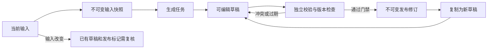

# CRSM 全栈优化与完善计划

版本：规划稿 1.0。日期：2026-10-26。审查基线：`38aaa2b` / 桌面版 `0.1.0`。

用途：作为 ZCode 的长期实施目标及验收依据。配套资料：[当前审查](CRSM-BASELINE-AUDIT-2026-10-26.md)、[业务术语](../../GLOSSARY.md)、[可直接转交的目标](CRSM-ZCODE-GOAL.md)。本文描述目标设计，尚未实现。

## 1. 项目定位与完成范围

将“本地导入课表、自动排班、导出 Excel”的桌面工具，完善为**面向一个学院行政办公室、支持老师与学生协作的课表约束排班系统**。主交付形态是可部署的 Web 全栈应用，Python 后端；现有 Vue 前端继续演进。

用户希望先让 AI 完成可用项目，再系统学习。因此实施应持续推进完整目标，阶段末用可运行成果和验证记录汇报，不沿用旧教学契约的“每完成一个模块即停下等学习确认”。F04 手调应纳入本次完整目标；交接文档中过去暂缓该功能的备注不构成本次再次请示的前置条件。

最终主流程：

> 创建学期/规则 → 维护当期助理 → 学生提交或老师批量导入课表 → 核对异常 → 预检可行性 → 选择快速/优化排班 → 比较方案 → 手动微调/锁定 → 校验并发布 → 学生查看、请假和申请调班 → 审批形成新修订 → 导出、追溯、备份恢复。

完成范围分为三类，全部纳入总目标：

| 来源 | 内容 | 完成要求 |
| --- | --- | --- |
| 原始 O 类 | F01～F08 及后续已确认修订 | 全部补齐，不能把 F04/F06/F07 移到“以后再做”后宣告完成 |
| 可靠性 R 类 | 审查 P01～P08、导入事务、发布原子性、版本和权限 | 有实现与自动验证；发现行为不能当作兼容性要求照搬 |
| 全栈增强 N 类 | 账号权限、学期、学生端、双求解器、后台任务、部署恢复 | 前端、API、数据库和异常流程形成闭环 |

本期规模控制：一个部署服务一个学院办公室；管理员、排班老师、学生三类固定权限。暂不做多租户计费、复杂组织权限平台、微服务、Kubernetes、通用工作流引擎、人脸考勤、工资系统、LLM 智能体或任意脚本插件。Tauri 旧版保留为历史成果和数据迁移来源，本期验收以 Web 版为主，不同时维护两套完整业务后端。

“实用”的证据是完整业务、可运行部署、恢复演练和明确限制；真实用户数量、使用时长和性能提升只能在取得实际证据后写入项目经历。

## 2. 推荐技术方案及边界

Python 是用户已选要求。以下是据此给出的实施基线，不是当前仓库已有技术：

| 层次 | 建议 | 选择原因 |
| --- | --- | --- |
| 前端 | Vue 3、TypeScript、Element Plus、Vue Router、按需使用 Pinia | 复用现有页面与交互；按功能拆组件，集中 API/错误处理 |
| Web 服务 | Django 5.2 LTS 的受支持补丁版本、Django REST Framework | 账号、权限基础、ORM、迁移、事务和管理后台统一，适合资料与审批密集的业务 |
| Python | 以 3.12 为初始兼容基线，M0 核验后锁定 | 同时验证 Django、OR-Tools、Celery 在 Linux 镜像上的兼容性 |
| 数据库 | PostgreSQL，M0 锁定受支持主版本，优先验证 17 | 真实事务、行锁、条件更新和约束；不以 SQLite 替代并发验收 |
| 求解 | 纯 Python 修正版贪心 + OR-Tools CP-SAT | 快速可解释基线与约束优化对照；共同输入、共同评价器 |
| 文件 | Python openpyxl；现有解析规则迁移并建立对照夹具 | 解析、导出和权限在服务端统一；学院格式与标准明细模板并存 |
| 任务 | Celery + Redis；PostgreSQL 存任务状态与结果 | 处理求解、批量导入和多周导出；前端轮询即可，无需先引入 WebSocket |
| 契约与质量 | OpenAPI（如 drf-spectacular）+ 生成 TS 类型；pytest/pytest-django、Vitest、Playwright、Ruff | 避免两端接口漂移，验证纯域、数据库事务与完整用户流程 |
| 部署 | Docker Compose、反向代理、生产 WSGI/ASGI 服务 | 本地和服务器环境一致；Django 开发服务器不作为部署方案 |

使用 Django ORM 与 Django migrations，不再并列引入 SQLAlchemy/Alembic。Django admin 用于受控运维和初始化，不替代老师/学生业务页面。Redis 作为队列基础设施，不保存唯一的一份业务事实。文件初期用持久化目录及受权下载，不强制引入对象存储。

M0 必须记录实际依赖版本、锁文件、镜像版本及选择依据，不使用无版本的 `latest` 部署。若依赖兼容性要求调整版本，写 ADR 并附验证；不因个人偏好重选整套框架。

官方依据：Django 下载页列出 [5.2 LTS 的支持期](https://www.djangoproject.com/download/)；DRF [对象权限的限制](https://www.django-rest-framework.org/api-guide/permissions/#limitations-of-object-level-permissions)说明列表过滤仍须自己实现；OR-Tools [状态定义](https://developers.google.com/optimization/cp/cp_solver)区分可行与已证明最优；Celery [任务文档](https://docs.celeryq.dev/en/stable/userguide/tasks.html)要求考虑幂等与重复执行。这些依据支持技术选择，具体业务协议由本计划定义。

## 3. 架构组织：模块化单体与纯排班内核

建议保留前端现有目录，逐步按功能整理；增加 `backend/`、`deploy/` 和实施记录目录，避免无业务收益的大规模文件搬家。

```text
src/
  api/                       类型化客户端、CSRF、错误映射
  features/                  accounts/terms/assistants/timetables/rosters/requests
  components/                共用展示组件，不隐藏业务写入
backend/
  config/                    Django 配置、路由、Celery 配置
  apps/
    accounts/                登录、固定角色、账号与助理关联
    academics/               学期、日历、节次、当期参与记录
    timetables/              课表版本、批量导入、解析模板
    rostering/               规则、快照、草稿、发布、导出模板
    workflow/                请假与调班审批
    operations/              文件引用、任务、outbox、审计
  domain/scheduling/         纯 Python；不 import Django/ORM/Celery
    problem.py               标准输入及预检
    constraints.py           可用性、连续段等业务语义
    greedy.py                快速基线
    cpsat.py                 优化求解器
    evaluate.py              独立终态校验与质量指标
    compare.py               差异与变动原因
  tests/                     单元、PostgreSQL 集成、API、基准夹具
deploy/                      镜像、Compose、代理与初始化配置
docs/implementation/         任务台账、需求验收矩阵、验证记录
docs/architecture/           ER 图、状态机、接口和新增 ADR
```

模块目录可随实际实现小幅调整；边界必须保持：

1. 页面经 API 读写服务端业务数据；IndexedDB 不再与 PostgreSQL 同时承担当前业务真相。
2. 应用服务负责权限、数据库事务、版本检查和任务提交；求解内核只接收不可变普通数据，输出方案与解释。
3. 解析模块从文件生成“待验证导入结果”，不自行更新人员和发布排班。
4. 两个求解器使用同一问题模型和评价口径。评价器不能直接相信求解器自己上报“无冲突”。
5. 只给实际可替换的求解器/文件解析器建立小接口；避免为每张表添加无用途的通用 Repository、事件总线或插件框架。

核心接口建议：`build_problem(snapshot)`、`solve(problem, options)`、`evaluate(problem, assignments)`、`compare(before, after)`。结果包含策略版本、输入哈希、状态、耗时、质量向量、问题明细；不能只有一份二维数组。

## 4. 业务模型、学期与时间语义

### 4.1 主要数据对象

| 对象 | 关键内容与关系 |
| --- | --- |
| Account / TeacherTermAccess | 固定角色、启停状态、老师可管理的学期；学生账号只关联自己的助理档案 |
| Assistant | 学号、姓名、身份、电话、QQ、班级；学号是业务标识，助理不等同于登录账号 |
| Term / CalendarDay / SectionDefinition | 学期周次、具体日期、教学星期、停课/补课映射；节次标识、序号、显示时间和工作区段 |
| AssistantEnrollment | `(term, assistant)` 唯一，参与状态、每周个体目标上下限、提交状态；跨学期不串配置 |
| TimetableVersion / CourseMeeting | 每次导入/手改形成课表版本；课程编号、类别、周次、教学星期、节次、原文和来源位置 |
| ImportProfileVersion / ImportBatch / ImportItem | 版本化解析配置；批次和每个文件的结果、错误、哈希及幂等信息 |
| RuleSetVersion | 规则、排班周期、优先级策略、发布缺口政策；已被快照引用的版本不可原地改写 |
| AvailabilityException / Preference | 请假等不可用性与软偏好分开存储，具有效期和审批状态 |
| InputSnapshot | 人员、规则、日历、课表版本、例外及 `input_revision` 的固定集合；保留可复算的规范数据 |
| RosterDraft / DraftEdit / Assignment | 草稿归属、输入快照、`lock_version`；安排显式带学期、周次、日期/教学日、节次、来源与锁定 |
| PublishedRevision | 递增发布修订号、完整安排及输入快照、发布人/时间、缺口确认原因；历史不可变 |
| ChangeRequest | 申请人、原安排、目标安排、所依据的发布版本、状态和审批意见 |
| Job / OutboxEvent / AuditEvent / StoredFile | 持久任务及租约、待投递事件、关键变更审计、受控文件引用 |

PostgreSQL 通过外键、唯一键、非负/上下界 CHECK 等兜底；跨多行的人数、连续段和总工时约束由业务服务和评价器保证，不能声称一个 CHECK 就解决全部约束。

必要索引围绕实际查询建立，例如 `(term, assistant)`、`(timetable_version, teaching_weekday)`、`(revision, week_no, date, section)`、任务状态/到期租约、outbox 待发送状态；用查询数量和执行计划验证，避免给所有字段盲目加索引。

### 4.2 必须统一的业务口径

- 值班量单位为**节**，个人上下限按**每周**计算，沿用现有算法实际语义；跨周期公平性另算指标，不偷偷把周上限改成全周期上限。小时展示按实际分钟换算，不能混为同一字段。
- 默认工作日周一至周五，上午 1～4 节、下午 6～9 节；保留单节一行、已有时间显示和数字/中课/晚课的真实先后序。节号不是序号，连续性也不能跨午休或不同工作区段拼接。
- 学期以明确的第 1 周起始周一计算日期；停课关闭实际日期，补课用显式教学星期映射。课程按教学日计算，页面和导出显示实际日期。对未配置的特殊校历不给出猜测。
- 时间戳使用带时区时间并统一存储，业务日历按 `Asia/Shanghai` 解释；不能直接按 UTC 日期截断生成教学日。
- “每周相同”模式使用覆盖周期的可用性并集生成教学周模板，再映射到各周日历；停课日不排。若各周锁定不兼容，解释冲突并拒绝生成，不能把当前周锁定自动广播到其他周。
- “未上传课表”不代表“全天有空”。提交状态至少区分 `missing / confirmed_empty / ready / needs_review`。默认只有 ready 或本人/老师明确确认无课的助理可参与自动排班。
- 同课程号可能有实验分批、不同周次或多个时段，不能以课程号为唯一键删除其余条目。
- 学生身份类型（本科/研究生）影响业务策略，账号角色影响权限，两者分离。
- 已进入发布历史的助理采用当期退出/归档，保留历史引用；未被历史引用的数据可按业务规则删除。需要替代旧版简单级联删除的范围，在新 SRS 中写清。

## 5. 算法深化：约束、双求解器、增量与解释

### 5.1 统一约束与发布政策

| 类别 | 规则 | 不满足时 |
| --- | --- | --- |
| 不可豁免硬约束 | 有效参与资格；课程与已批准请假不重叠；时段存在；不重复安排；时段上限；个人每周上限 | 方案无效，阻止保存为有效结果及发布；手动来源和锁定均不能绕过 |
| 连续性 | 自动安排必须满足最少连续节数，按真实顺序及工作区段识别完整连续段 | 贪心也必须终态合法，不能用加回孤立节次填补目标 |
| 原始手动例外 | 原 SRS 允许手动短段；升级为老师显式勾选连续性例外并填写原因 | 仅对明确的手动安排生效，审计并展示；不能豁免课程/人数/个人上限，也不能为新自动单节提供豁免 |
| 锁定 | 合法锁定是求解等式约束，完整标识周次与时段 | 输入冲突锁定给出错误与处理入口；不得静默丢弃或搬移 |
| 默认软目标 | 时段覆盖下限、个人每周目标下限、均衡、公平、偏好、减少变动 | 返回缺口和质量分项；不足不意味着允许突破硬约束 |
| 发布门禁 | 数据待核对、硬冲突、输入过期均阻止发布；覆盖/目标不足默认需老师确认原因 | 确认原因与质量摘要写入发布版本，不能以普通绿色“成功”掩盖 |

手动来源 `source=manual` 与 `is_locked` 是两个概念。新手调默认锁定，允许老师明确解锁；旧数据导入时有效手动项默认转为锁定，非法项进入待处理清单。连续性例外需要独立字段与理由，不以 `source` 自动推断。

所有入口使用同一服务端语义：规则修改、自动生成、手调、课程变更影响分析、锁定验证、调班审批及发布。前端可做快速提示，但服务端是最终判断依据。

### 5.2 生成前预检与独立评价器

`build_problem` 完成严格类型/范围检查、输入标准化、按周课程占用、资格和例外合并、候选集合及锁定核查；区分三种结果：输入非法、合法但目标难以满足、硬约束不可行。

例如某人的上限小于最短连续段长度，可能只意味着该人在本期不能被自动安排，不能不加区分地认定整个问题硬约束无解；空安排与明确软缺口仍可能合法。只有业务配置明确把相应下限升级为严格要求时，才按该硬约束判定。

预检至少输出：未交/待核对人员、每时段有效候选、候选连续块、每周需求与容量、个人可用量不足、锁定冲突。例如 `max(0, 最低覆盖需求总量 - 所有个人上限总量)` 只是缺口的一个下界，不是充分可行性判据，也不能与其他下界简单相加重复计数。

独立评价器对**最终安排重新计算**：课程/请假重叠、时段/个人上限、重复、连续段及其豁免、锁定保留、覆盖缺口、个人目标不足、空白工作日、公平性和变更数。用 P01～P08 反例建立修复后的正向验收，不调用求解器内部“已校验”标志替代计算。

### 5.3 修正版贪心

先移植纯 Python 版本，保留稀缺时段优先和局部修复的可解释基线；以当前 TS 脱敏夹具验证业务对齐。兼容测试只要求正确语义，不要求保留已经证明有问题的输出。

按连续块进行加入/移动/移除，保护锁定；每一步考虑硬约束，最终再次独立评价。修复失败返回合法的部分解与缺口，不通过“循环若干次”假定已收敛。相同输入与明确 tie-break/seed 产生稳定结果，记录策略版本。

### 5.4 CP-SAT 优化器

定义布尔变量 `x[assistant, week, date, section]`，仅为可安排组合建变量；加入硬约束、连续性、锁定和每周相同模板约束。连续段采用可验证的区间块或自动机建模，覆盖上午/下午断点、命名节次、手动例外及“删除中间一节”边界。

默认使用有优先级的目标向量，顺序明确且在 UI 显示：

| 配置 | 从高到低的软目标 |
| --- | --- |
| 全量排班 | 每日均衡开启时减少空白工作日 → 覆盖缺口 → 每人目标不足 → 归一化负担差异 → 所选优先策略/偏好 → 不必要的超额覆盖 |
| 增量重排 | 每日均衡/覆盖/目标不足 → 相对基准的改动数 → 公平与策略/偏好 → 超额覆盖 |

这保留原 SRS 在资源不足时“每天有人”优先的取舍；关闭每日均衡即移除该级，停课日不计入空白工作日。默认公平性使用个人已分配节数/对应周期有效上限总量的归一化负担差异，并单独列出原始节数；无有效上限或不参与的助理不进入除法。CP-SAT 使用有明确误差界和整数系数的等价/近似指标，尺度与计算方式写入策略版本，避免把不同个体要求硬拉成相同工时。

提供有限策略预设：稀缺空闲优先、身份优先、轮换优先。身份优先不能突破资格与安全约束；轮换参考既有发布负担且保持稳定 tie-break。无需做任意表达式引擎。

可采用分阶段词典序求解或有可证明上下界的整数权重。采用分阶段时共享总时间预算，只有已证明最优的层才能固定为全局最优值；时间耗尽时返回已得可行解、每层状态及界限，不把暂时最好值冒充最优。

严格区分 OR-Tools 的 `OPTIMAL / FEASIBLE / INFEASIBLE / MODEL_INVALID / UNKNOWN`。`UNKNOWN` 不是无解证明；贪心未填满也不是无解证明。求解器错误或超时可返回已通过评价器的基线方案，必须显示实际采用策略及降级原因。

同一新输入可先运行贪心，存在通过评价的方案时作为 CP-SAT hint 和质量对照；贪心未找到硬可行解不能阻止 CP-SAT 尝试。预算结束后按共同目标向量选择合法候选中的较好结果，不能把更差方案标成“优化”。分别保存 CP-SAT 原始状态、最终采用策略及评价器结论；采用基线时不伪造 CP-SAT 的 FEASIBLE/OPTIMAL 状态。

### 5.5 真正的增量重排与解释

重排必须选择基准草稿/发布版本及目标周次；读入新课程、人员、规则后重新建问题。有效锁定保持不动，既有自动安排以变动惩罚保留；变动按完整 `(assistant, week, date, section)` 集合计算，增加和移除分别列出。

仅重排部分周时，将结果合并回完整学期方案；范围外安排保持不变，最终评价覆盖整份待发布修订。均衡跨周或硬上限口径变化需要明确 ADR，不能悄悄影响范围外历史。

展示保留、增加、移除、替换及对应原因：课程变化、请假、当期退出、规则变化、消除冲突、改善覆盖、目标权衡、老师手调。原因可以是可验证的规则与候选统计，不能承诺能证明每条 CP-SAT 决策的唯一因果。

每个缺口给候选淘汰统计与可采取的动作；明确哪些是必要性检查、哪些是已证明不可行。最小不可满足核心不是本期必须实现，避免用“智能解释”占位。

### 5.6 算法质量证据

建立可复现的合成基准：资源充足、容量不足、空白日、稀缺连续块、个体上限差异、单双周/实验分批、固定模板、冲突锁定、课程变更和大量部分周重排。

相同快照比较 TS 旧算法、修正 Python 贪心、CP-SAT；旧算法结果只作历史参照。必须保证新算法硬违规为零，并至少提供一个经穷举或可证明上界验证、CP-SAT 优于修正贪心的构造实例。若两者质量相同，也如实记录耗时差异；不预写“提高 30%”之类结论。

小规模用穷举 oracle 校验建模，随机性质测试验证不变量；记录 seed、硬件、库版本、时间预算、状态、输入哈希和质量向量。保存实际选中的输出支持审计，不承诺跨平台多线程 CP-SAT 的逐项输出必然一致。

## 6. 导入、课程编辑与模板：从文件操作升级为可靠流程

### 6.1 模板与解析

至少支持两种实际可用的导入 profile：现有学院网格格式、项目提供的标准明细格式。配置采用受控声明字段：工作表/表头定位、列映射、合并单元格处理、周次/节次/类别词典和版本；不允许上传任意 Python 脚本。

保留周次区间、单双周、多个课程块、实验分批及数字/命名节次的语义，保留文件、工作表、行/单元格位置与原始文本以便修正。不能把无法识别的条目静默丢弃。Word 转换指引延续原要求，直接解析任意 Word/PDF/OCR 不在本期范围。

模板编辑提供样例试解析与差异预览，保存新版本；旧课表版本仍引用旧解析版本。更换 profile 不自动重解释并覆盖历史课表。

### 6.2 批量导入与原子性

老师可拖入多份文件，展示每项识别出的归属、记录数量、异常和最终状态；学院标准模板解析成功后按学号自动归档，不增加逐人确认步骤。学生上传必须与自身关联身份一致；不能靠改表头替别人上传。

学号按字符串处理，保留前导零并规范空白；模板要求文本单元格。Excel 已损失的前导零不能猜测补齐，需要明确的归属错误或受控核对。

默认语义：**单份课表/单个学生更新原子，批次允许部分成功**。助理建档/可更新字段、课表版本、当前指针、学期输入版本与审计在一个数据库事务中完成；电话/QQ/班级等课表不能提供的字段保留。失败项不留下半个档案或半张课表，成功项不因其他文件失败全部回滚。

幂等键包含学期、归属、文件内容哈希和解析 profile 版本；重试同一项不产生重复课程/日志或重复版本，显式重新解析则生成新版本。一个批次同一学生出现两份不同内容，返回可见的重复归属冲突，不能按后台完成先后随机覆盖。

文件先进入暂存区，数据库提交后才成为有效引用。数据库事务无法回滚文件系统：用引用状态、孤儿清理和重试处理文件与数据库边界。失败注入要覆盖“文件存好但数据库失败”和“数据库成功但消息未投递”。

默认限制建议为单文件 5 MiB、每批 50 文件、总量 100 MiB，可通过配置调整；同时限制解压大小、条目数、工作表/单元格数量。只接受声明支持的真实工作簿，不执行公式、宏或外部链接；文件名和错误信息不得泄漏服务器路径。

### 6.3 手动维护课程

提供课程新增/修改/删除，支持周次、星期、节次、类别和实验分批；保存形成新课表版本，严格校验不覆盖其他条目。

变更后列出受影响草稿和当前发布版本的冲突。已发布版本保持原始记录，界面标记输入已更新/需处理，提供“以此版本创建重排草稿”。不能后台直接删除学生已看到的值班安排。未知节次进入 `needs_review`，可映射或更正后恢复 ready。

## 7. 草稿、手调、并发和发布

### 7.1 三种版本号分开

- `input_revision`：学期输入版本。人员资格、有效课表、规则、日历、批准的不可用性有变化时，在同一事务中递增。
- `lock_version`：草稿编辑版本。每次批量手调、撤销、重做都条件更新并递增；前端提交 expected version。
- `publication_number`：正式发布修订号。发布成功才递增，供学生、导出与审批引用。

生成任务从一致数据库视图建立输入快照：用短事务和统一学期版本锁或经验证的快照隔离读取；所有相关输入写入也遵循同一学期版本协议。不能先读一半课程、再读另一批已经更新的规则后拼为同一个“快照”。耗时求解在事务外执行。

### 7.2 草稿编辑与撤销/重做

生成结果先保存为草稿，老师可以比较、复制和调整。默认本人编辑自己的草稿，授权老师可查看/复制，管理员可移交；同账号多标签页仍须并发保护。

提供单格增删、跨时段移动、批量修改、候选推荐、锁定/解锁及连续性例外。拖动可以作为增强交互，表格按钮/弹窗必须完整可用；不能把“未来可拖拽”当功能完成。

一次移动/批量调整是一条原子编辑，先在服务端计算新状态并评价，再整体保存。不可豁免违规拒绝；软缺口实时展示；手动短段需要明确例外及原因。刷新后草稿和历史仍在。

撤销/重做基于草稿内版本链或快照链，需携带当前版本；只撤销当前可见编辑链的末端，不能把别人的后续操作用旧全局快照覆盖。撤销本身产生新 `lock_version`，版本号不能倒退。新编辑截断 redo 分支。

### 7.3 发布事务与不可变历史

发布请求携带草稿版本、预期学期输入版本和预期当前发布版本。一次数据库事务完成：

1. 按固定顺序锁定学期与草稿，校验权限及三个预期版本。
2. 比较快照输入是否仍最新，重算最终评价及发布门禁。
3. 创建不可变发布修订，写完整安排、质量报告及必要确认原因。
4. 原子更新学期当前发布指针，写审计及待通知事件后提交。

所有输入修改、调班批准与普通发布使用一致锁顺序。两人同时从旧版本发布，最多一个成功，另一个得到可处理的 409/版本冲突；不能静默覆盖，不能出现部分周已发布。

每学期默认只有一个当前有效发布版本。对部分周的变更也生成包含未变周的完整新修订；旧版本可查可导出。所谓回退是基于旧内容创建新草稿、对当前输入重验后发布新修订，不修改或删除历史版本。

## 8. 多角色实用流程

### 8.1 权限矩阵

| 能力 | 管理员 | 排班老师 | 学生 |
| --- | --- | --- | --- |
| 创建账号/角色、系统配置 | 是 | 否 | 否 |
| 学期、人员、规则和模板 | 全部 | 授权学期 | 查看与本人相关的公开信息 |
| 课表 | 管理 | 授权学期管理/批量导入 | 仅提交和查看本人，可确认无课 |
| 排班生成、手调、发布 | 是 | 授权学期 | 否 |
| 正式排班 | 全部版本 | 授权学期全部版本 | 本人值班；学期公共表仅按公开字段显示 |
| 请假/调班 | 管理审批 | 授权学期审批 | 提交/撤回本人申请，不能自批 |
| 电话导出、备份恢复、审计 | 按管理权限 | 获授权的导出和业务审计 | 无批量通讯录与管理备份权限 |

使用同源 Session + CSRF，登录本身也保护 CSRF；Cookie 属性、允许主机、HTTPS 代理配置、退出和会话过期完整处理。不做公开自注册；管理员创建账号并要求首次修改密码，演示账号仅在 demo 模式显式生成。

后端既检查动作权限，也按学期与本人过滤列表/详情/文件下载，不能只隐藏前端按钮。学生可见的公共表只展示姓名/值班，不包含电话、学号、QQ、完整课表或其他学生的申请详情。测试越权 ID 和列表泄漏。

### 8.2 请假与调班审批

请假状态为提交、撤回、批准、拒绝；仅批准后作为输入例外生效，并递增 `input_revision`。影响当前发布版本时创建待处理事项，由老师在新草稿处理；请假批准本身不悄悄改写发布历史。

调班首期支持：请求移交自己的连续值班块，或与指定助理交换明确安排；接收方涉及新增工作时需接受，老师最终批准。申请状态区分待接收、待审批、拒绝、撤回、已批准、因版本变化待重提。

批准时核对申请依据的发布版本、相关安排仍存在、双方资格与课程/请假/个人上限、连续性和锁定政策；通过后创建完整新发布修订并更新指针。版本已变化时重新评估或要求重提，不能把旧申请直接套到新排班。重复点击批准幂等，不生成重复修订。

站内通知至少覆盖课表需修正、发布、申请状态变化；通知引用业务对象和版本，可标记已读。无需接入短信/邮箱，也不自动向外部服务发送消息。

## 9. 后台任务、恢复与文件导出

### 9.1 持久任务协议

生成、批量导入和较大导出走后台任务。API 创建任务返回 202、任务 ID 和状态链接；前端显示阶段、进度/已处理项、耗时、错误、重试和取消入口。小的同步业务仍保持普通事务。

任务状态至少覆盖 pending、queued、running、succeeded、failed、cancel_requested、canceled；数据库记录参数/快照 ID、尝试次数、租约、执行 token、结果引用。业务状态以 PostgreSQL 为准，不靠 Celery result backend 保存唯一状态。

创建 Job 与 OutboxEvent 同事务；dispatcher 负责提交 Celery 并可重复投递，`on_commit` 可作加速提示但不能取代持久 outbox。Compose 同时启动 dispatcher。重启后可恢复待投递、租约过期任务，不让任务永远停在 running。

采用至少一次投递 + 幂等结果提交：同一任务结果唯一，worker 通过执行 token/版本条件更新，过期 worker 不能覆盖新尝试结果。不要宣称 Celery 提供业务恰好一次。

只对短暂基础设施失败有限重试，解析格式错误与非法规则直接失败并给修正建议。求解有总预算和可协作取消检查，取消后不再提交成功结果；如果需要保留可行中间结果，标记为可查看但未采纳草稿，语义写清。

### 9.2 导出及模板管理

服务端从指定草稿/发布版本及其快照导出，不能拿当前规则重新画历史版本。支持单周、多周多工作表、标准明细，以及模板版本、日期/节次时间、页眉页脚、列宽、打印方向/区域等受控配置；至少有默认学院版和简洁打印版。

保留每节一行和姓名/电话上下换行样式。老师“含电话”开关默认值延续现有习惯，仍须有电话权限；关闭后文件不写电话明细。**学号、QQ 一律不进入排班导出文件**，学生可访问导出只含允许的公开字段。导出服务不能信任前端传来的 `include_phone=true`。

所有用户文本按普通文本写单元格，避免姓名/备注被解释为公式；模板不接受任意公式执行。导出文件标明学期、范围、发布修订及生成时间，历史文件按权限下载，临时文件到期清理。

### 9.3 旧数据迁移与备份恢复

提供旧桌面版本的结构化导出工具及服务端一次性导入入口，明确数据版本、内容哈希、记录数、导入预演与报告。旧 IndexedDB 不能由远端 Python 直接读取；需要在旧数据所在的原 origin/旧 Tauri WebView 上下文导出后上传。普通浏览器打开新网页看不到已安装 Tauri 应用的数据库。必要时在归档旧版上提供只读导出补丁及操作指引，不能假定复制一个前端页面就能读取任意安装版数据。保留可回退的旧版本及原始导出文件。

历史记录按实际旧 schema/version 迁移；下午 8~11 是旧默认还是用户自定义无法判断时列为待核对，不按值猜。不可用“清空旧排班再生成”替代正式迁移；原始手调、联系方式和周次必须核对。

管理备份包括 PostgreSQL、上传文件、模板/配置版本与清单校验；账号密码哈希可随数据库备份，部署密钥与外部凭据不写 Git 或公开备份。提供命令行操作手册和受管理员权限控制的入口，恢复是明确的维护操作，不是普通上传覆盖按钮。

至少在全新数据卷恢复一次，校验记录数、文件哈希、当前发布指针、历史导出和账号权限。备份文件可恢复这一事实必须由演练证明。

## 10. 前端与工程质量

### 10.1 前端可用性

- 老师首页展示未提交/待核对课表、覆盖缺口、输入已变更的发布版本、任务和待审批项；点击直达处理位置。
- 排班页分清输入、方案、质量、差异和发布状态；一周一页单节网格，历史周可发现，规则范围变化不会隐藏已有历史。
- 规则表单显示有效个人覆盖与目标优先顺序，非法组合定位到字段；日历补课、课程修改可预览影响。
- 学生端适配手机，提供本人课表提交状态、近期值班、请假/调班和申请进度。
- 加载、空状态、权限失败、会话过期、任务失败、版本 409 均有可操作文案；提交去重，网络失败不丢表单。
- 延续声明式弹窗、单节一行、无无效 BACK 按钮；键盘可操作，不只靠红绿颜色提示，表格溢出与中文长名有实际验证。

### 10.2 工程要求

统一错误结构（业务 code、message、字段错误、冲突明细、request_id）；统一 API 版本前缀。OpenAPI 与 TS 类型随 CI 校验，长任务接口、分页、批量操作和版本冲突都写契约。

建议 API 边界如下，具体 URL 可以调整，业务动作和版本条件不能缺失：

| API 组 | 典型接口 | 关键约定 |
| --- | --- | --- |
| 会话/本人 | `POST /api/v1/auth/login`、`logout`，`GET /me`、`/me/duties` | CSRF、会话、本人作用域；不在请求体接受任意角色升级 |
| 学期/人员 | `/terms`、`/terms/{id}/enrollments`、`/terms/{id}/calendar` | 授权学期、分页、输入版本递增 |
| 课程与导入 | `/terms/{id}/import-batches`、`/timetables/{id}/versions`、`/import-profiles` | 批次 202、逐项结果、幂等键；课程编辑返回新版本 |
| 生成/任务 | `POST /terms/{id}/generation-jobs`、`GET /jobs/{id}`、`POST /jobs/{id}/cancel` | 快照 ID、策略/预算、基准和目标周次；不接受前端伪造最终质量结论 |
| 草稿编辑 | `/roster-drafts/{id}`、`/edits`、`/undo`、`/redo`、`/compare` | expected lock_version；一次批量编辑原子提交 |
| 发布/历史 | `POST /roster-drafts/{id}/publish`、`GET /terms/{id}/publications` | 预期输入/草稿/当前发布版本；发布内容只读 |
| 协作申请 | `/absence-requests`、`/change-requests`、`/{id}/accept`、`/{id}/approve` | 服务端状态机、本人/老师权限、重复提交和批准幂等 |
| 文件/模板 | `/export-templates`、`/export-jobs`、`/files/{id}/download` | 服务端电话权限、历史快照、受权下载、过期时间 |

普通字段错误使用统一的 400 响应，认证/CSRF/授权沿用框架一致的 401/403 处理并由客户端识别，会话失效引导重新登录；版本冲突使用 409，包含当前版本及刷新/复制草稿的处理信息。幂等键作用域至少包含操作类型与操作者；同一个键配不同负载返回冲突，不能复用旧结果误报成功。

状态转换应落实为服务方法及测试，不能只画图。下面概括排班主状态：



按功能拆分过大的 ScheduleView/CoursesView，把数据库/求解调用移出展示组件；前端状态只持有页面和认证必要信息。服务端领域逻辑不散落到 serializer 的隐式副作用或 Django signals 中。

审计覆盖导入、规则、手调、发布、审批、迁移和恢复；记录操作者、对象、前后版本、原因和 request/job ID，避免把整份课表和电话写入普通日志。错误日志可追踪任务与请求，不暴露生产 traceback 给用户。

优化 API 分页、关联预取和查询数量；按路由/功能延迟加载工作簿等重依赖，记录构建包与加载前后数据。不得仅调整 chunk 警告阈值作为优化成果。

部署包含 frontend/proxy、backend、PostgreSQL、Redis、worker、dispatcher；数据库/Redis 不向公网开放。初始化/迁移为明确步骤，服务就绪检查、持久卷、配置示例、生产 `DEBUG=False` 和可用健康检查齐全。

## 11. 实施顺序与任务拆分

任务编号供 ZCode 建台账，不代表只交付计划。每阶段都要接通 UI/API/数据的必要切面，并在条件满足后继续下一阶段。除明确外部阻塞，不以“等待用户学习”暂停。

| 阶段 / 依赖 | 任务 | 可审查成果与完成条件 |
| --- | --- | --- |
| M0 基线与设计 | M0.1 复核 HEAD、原始需求和审查反例；M0.2 建 O/R/N 需求矩阵与任务台账；M0.3 锁依赖、探测 Docker/Python、建立演示数据规则；M0.4 新增全栈 SRS、架构/算法/版本 ADR | 基线测试记录、迁移保护方案、版本兼容验证、小型双求解器安装 smoke；缺失环境写明，不假定已运行 |
| M1 最小全栈纵切 / M0 | M1.1 Django/PG/迁移/配置；M1.2 登录、CSRF、角色与老师学期权限；M1.3 学期/当期人员 API 与 Vue 页面；M1.4 OpenAPI/客户端/CI 基础 | 老师能登录创建学期和助理、学生只能访问本人；数据刷新保留，PG 约束测试通过；这是中间里程碑，不是最终完成 |
| M2 课表与可靠导入 / M1 | M2.1 时间/周次规范模型；M2.2 迁移学院解析器及标准明细模板；M2.3 原子归档、批次结果、幂等和数据质量；M2.4 课程手改及影响分析；M2.5 profile 版本后端 | 多文件成功/失败混合可恢复，未知数据待核对，手改保留历史；前端可操作。先用应用服务实现，M6 再接持久后台执行 |
| M3 统一评价器与快速排班 / M2 | M3.1 规则/个体覆盖/策略配置；M3.2 一致输入快照及预检；M3.3 纯 Python 贪心与终态校验；M3.4 P01～P08 回归 | 不含无效硬冲突的方案、真实缺口和可解释报告；保留旧夹具语义但修复已知缺陷 |
| M4 手调与发布 / M3 | M4.1 草稿与版本链；M4.2 增删移动/锁定/例外/undo redo；M4.3 发布门禁与不可变修订；M4.4 PostgreSQL 并发故障用例 | 手调与发布 UI 闭环；双标签页编辑和双发布冲突可见，输入变化后过期草稿不可直接发布 |
| M5 优化求解与稳定重排 / M4 | M5.1 CP-SAT 模型和目标；M5.2 全量/增量与部分周合并；M5.3 差异解释和质量看板；M5.4 小规模 oracle/性质测试/基准 | 双求解器真实可选，构造实例证明优化收益，合法锁定不动，增量变动可量化；达到本项目算法深度要求 |
| M6 后台执行与恢复 / M5 | M6.1 Job+outbox+dispatcher；M6.2 Celery 求解/导入/导出；M6.3 轮询/重试/取消；M6.4 崩溃、重复投递、过期 worker 测试 | 进程重启后任务可恢复，重复执行无重复业务结果，前端不假装进度；各阶段时间预算共享 |
| M7 学生协作闭环 / M4、M6 | M7.1 学生页面与本人提交；M7.2 请假/不可用性；M7.3 接收调班与老师审批；M7.4 站内通知 | 发布可见、申请/接受/审批/新修订完整跑通；旧发布申请冲突和重复批准已验证 |
| M8 模板、导出与数据资产 / M2、M4、M6 | M8.1 导入/导出模板管理 UI 和试解析；M8.2 多周/历史导出与电话权限；M8.3 旧版导出和迁移预演；M8.4 备份恢复工具 | F07 两类模板均完整，真实生成文件可校验；旧样本迁移与全新卷恢复通过 |
| M9 完整交付 / M5～M8 | M9.1 交互/响应式/包体和查询优化；M9.2 E2E/性能/CI/部署；M9.3 需求矩阵清零；M9.4 演示与学习资料 | 下方 A01～A32 全部有证据，README 可从空环境复现；未完成或未验证项不能包装为完成 |

M2 的 profile 底层与 M8 的管理 UI、M3 的独立内核与 M5 的优化器、M4 的事务与 M6 的任务协议是明确依赖，不能用后阶段名称代替前阶段实际实现。允许调整相邻任务顺序以接通纵切，但不能删掉算法、发布或恢复等困难部分。

## 12. 验收矩阵

ZCode 应把每项映射到真实测试/演示/文件，记录命令、环境和结果。此处是验收规格，不是当前通过声明。

| 编号 | 场景及通过标准 | 主要验证层 |
| --- | --- | --- |
| A01 | 空数据库按 README 初始化，迁移、演示账号和必要模板可重复创建；重复执行不污染业务数据 | Compose/脚本 |
| A02 | 登录/退出/过期与 CSRF；缺少有效 CSRF 的写请求包括登录被拒绝 | API + E2E |
| A03 | 学生改 ID、调列表参数、下载他人文件均不能访问他人隐私；老师不能访问未授权学期 | API + PG |
| A04 | 两个学期同一学生分别设置课程和个体目标，排班互不串数据 | 集成 |
| A05 | 数字节次/中课/晚课、单双周、实验分批、停课/补课映射正确，连续性不跨工作区段 | 纯域 + 解析 |
| A06 | 学院样例与标准明细模板解析为预期结构，未知条目定位到来源并进入待核对 | 夹具 + UI |
| A07 | 批次 3 份合法、1 份损坏、1 份重复归属冲突；结果逐项明确；重试失败项不复制成功项 | 集成 + E2E |
| A08 | 在建档、课程写入、当前指针切换等边界注入失败，单学生更新全回滚；文件孤儿可清理 | PG 事务 + 文件 |
| A09 | 缺课表者不视为空闲；显式确认无课者可参与；学生不能冒充其他学生上传 | API + 求解 |
| A10 | 手改课程产生新版本和受影响安排报告，旧发布版本内容不改变 | 集成 + E2E |
| A11 | 负数/小数/越界星期、上下限倒置、重叠区段等输入均有字段错误；目标容量不足与输入非法分开 | API + 纯域 |
| A12 | 两个求解器及所有保存/发布路径最终均通过独立评价，包含连续段；覆盖 P01/P02/P08 | oracle + 性质测试 |
| A13 | 合法锁定不被均衡或增量搬移，周 1 锁定不传播到周 2；非法锁定明示；覆盖 P03/P04 | 纯域 + 集成 |
| A14 | 未知节次在求解与冲突页均显示待核对，不把空冲突列表作为“已安全”；覆盖 P05 | 纯域 + UI |
| A15 | 资源不足时结果合法且缺口量正确；每日均衡开关和身份/稀缺/轮换策略按文档改变优先级 | 基准 + 纯域 |
| A16 | CP-SAT 状态/超时/降级如实展示；小实例与穷举一致，并有至少一个优于修正贪心的实例 | oracle + 基准 |
| A17 | 无输入变化且基准已满足前级目标时，增量保持零改动；单人课程变更保护锁定、变更量/原因正确；部分周范围外保持，最终整份方案合法 | 集成 + 基准 |
| A18 | 手动增删/移动为原子操作；安全冲突拒绝；短段例外需理由且可追溯；刷新不丢草稿 | API + E2E |
| A19 | 撤销/重做恢复正确状态且版本递增；新编辑截断 redo；陈旧标签页不能覆盖新编辑 | PG + E2E |
| A20 | 两个编辑请求使用同一版本时最多一个成功，另一个得到冲突；无丢失更新 | PostgreSQL 并发 |
| A21 | 输入变化后旧草稿发布被拒绝；双发布/发布与调班批准竞争只产生一个合法当前指针；全周期无部分发布 | PostgreSQL 并发 |
| A22 | 新发布不改旧发布；可查/导出旧版本，回退通过新修订且重新校验当前输入 | 集成 + E2E |
| A23 | outbox 提交后消息投递失败、重复投递、worker 崩溃/租约到期均可恢复，旧 worker 不覆盖新结果 | 进程故障 + PG |
| A24 | 取消/重试有确定状态；非法文件不无穷重试，重复任务不产生重复课表或草稿 | 集成 + E2E |
| A25 | 请假批准后进入有效不可用性并标记排班影响；调班经接收/审批才生效，过期申请与重复批准正确处理 | API + E2E |
| A26 | 导入和导出模板均可新增版本、测试样例和切换；旧课表/旧导出引用稳定 | 集成 + 文件检查 |
| A27 | 单周/多周/历史导出日期与时间正确、单节行/打印样式可读；关闭电话后所有 sheet 均无电话；始终无学号/QQ | 工作簿内容 + 视觉抽检 |
| A28 | 旧版导出预演数量一致，手调/联系方式保留；歧义 8~11 配置待核对，不静默迁移；覆盖 P07 | 迁移夹具 |
| A29 | 全新数据卷恢复数据库与文件，哈希/记录数/发布指针一致，恢复后可登录并导出旧版本 | 恢复演练 |
| A30 | 老师完整主流程与学生手机主流程有 E2E，含空状态、失败、409 与权限分支 | Playwright + 手工记录 |
| A31 | 达到第 13 节性能口径，CI 全绿，数据库迁移可从空库及上一版本升级 | 基准 + CI |
| A32 | README、ER 图、状态机、API、ADR、部署/故障/学习指南与真实代码一致；没有伪造用户/效果指标 | 交付核对 |

## 13. 性能、测试与交付证据

### 13.1 性能目标

保留原 SRS 的规模基础并补充测量口径；这些是待实现目标，不是现有测量成绩。

| 项目 | 验收目标与测量方法 |
| --- | --- |
| 快速排班 | 50 助理 × 17 周 × 5 天 × 8 节，修正贪心包含建模/评价的计算时间 ≤5 秒；固定数据、记录 CPU/内存/Python 版本 |
| 优化排班 | 同一标准数据默认 5 秒优化预算，提供最高 30 秒模式；共享总求解预算，按实际 FEASIBLE/OPTIMAL 返回；记录建模、求解、评价和总耗时，禁止无限卡住 |
| 解析 | 标准单份学院课表解析 ≤3 秒；分别报告文件读取、解析和数据库提交，畸形/超限文件快速拒绝 |
| 页面 | 标准数据下主要页面可交互 ≤2 秒，记录冷/热加载、路由分块与查询数量；长任务显示已受理不等同于任务已完成 |
| 常用 API | 在记录的本机/Compose 环境、10 并发用户下，普通列表/详情目标 p95 ≤1 秒，至少 30 次测量；导出/求解不占同步请求 |
| 扩展测试 | 200 助理 × 20 周作为压力样本，报告耗时/内存/质量/预算结束状态，不宣称达到未经验证的同样 SLA |

M0 先记录参考机器条件，M9 使用同一环境重复测量；若实测不达标，优化或明确未完成，不能删掉约束或缩小样本后不说明。

### 13.2 自动验证层次

1. 纯域：解析语义、严格规则、连续段、锁定、评价、差异、两求解器、小规模穷举及固定 seed 性质测试。
2. PostgreSQL：业务唯一键、导入事务、快照一致性、草稿 CAS、发布竞争、审批幂等、任务执行 token；并发用独立连接，不在 SQLite 或单个回滚事务里假装行锁已测。
3. API：认证/CSRF/对象与列表权限、输入错误、分页、状态机非法转换、版本冲突和文件权限。
4. 端到端：演示数据从提交到发布、学生申请与老师处理；批量部分失败、历史导出和恢复关键路径。
5. 部署：空库启动、升级迁移、持久卷、健康检查、worker/dispatcher 重启、备份恢复。

CI 至少执行前端类型检查/构建/Vitest、后端 Ruff/pytest、PostgreSQL 集成、迁移检查与关键 Playwright。适合本项目的小规模固定基准入 CI；完整性能与恢复演练保留单独可执行命令及报告。

目标不是堆测试数量：断言应验证业务不变量、故障后状态和权限边界；不能只 mock ORM 后声称事务已通过，也不能把审查中错误输出作为期望快照固化。

### 13.3 实施台账与 Definition of Done

新增并持续维护：

- `docs/implementation/TASKS.md`：M0～M9 的可执行子任务，状态 pending/in_progress/blocked/verified，依赖、提交/文件和下一步。
- `docs/implementation/ACCEPTANCE.md`：O 类 F01～F08、R 类 P01～P08、N 类能力及 A01～A32 的实现与验证映射。
- `docs/implementation/VERIFICATION.md`：实际命令、日期、环境、通过/失败/未运行、必要输出和产物位置；不写未经执行的“全部通过”。
- `docs/implementation/DECISIONS.md`：业务默认值与待解决问题索引，重要取舍链接独立 ADR，避免重复矛盾记录。

单个任务 verified：代码、页面/API、必要数据迁移、业务验证及文档都齐；只写后端接口或只画前端静态表不能算对应业务完成。

整个目标完成：M0～M9、原始 F01～F08 和 A01～A32 均有对应证据；从空环境部署演示成功；恢复演练完成；双求解器与增量、并发、任务异常路径均实际验证；已知问题和限制诚实列出且不包含本期必交付缺项。

Docker、数据库或其他外部依赖缺失时，继续推进不依赖它的代码与纯域验证，明确列出未验证项及最小环境需求。不能以缺环境为理由换用 mock 宣称通过，也不能在只有 CRUD 或脚手架时标记整个目标完成。

## 14. AI 完成后交给用户学习的材料

最终成果除代码外，应包含与实现一致的学习入口：

1. **启动与演示**：一条明确的本地启动路径、合成演示数据和 10 分钟讲解脚本，展示正常流程及至少两个异常分支。
2. **业务与数据**：术语、F01～F08 对照、ER 图、学期/版本关系、任务与审批状态机。
3. **关键调用链**：课表导入、生成任务、一次手调、发布、一次调班批准各自从 Vue 到 API、事务/任务及数据库的真实文件导航。
4. **算法说明**：约束表、CP-SAT 变量与目标、连续段建模、增量惩罚、独立评价器、基准复现与状态限制。
5. **工程说明**：为何用 Django、为何保留纯域、事务与锁协议、outbox/幂等、权限、备份恢复、故障定位实例。
6. **学习路线**：先跑业务和读模型，再跟调用链、阅读算法、运行/改写测试，最后做小改动；每步给真实代码位置和练习。
7. **项目经历事实表**：已实现能力、个人后续能讲清的设计、实际测量与证据链接；不编写未经用户掌握或未经真实验证的工作经历。

至少准备六个可练习的问题：贪心为什么会失败；连续段如何编码；增量为什么改动更少；为什么课程变化阻止旧草稿发布；双发布如何防覆盖；为什么有 Celery 还需要幂等与 outbox。答案必须对应实际实现和测试。

## 15. 实施期间的约束与优先处理风险

| 风险 | 必须执行的处理 |
| --- | --- |
| 只做 Web CRUD，核心能力再次延期 | M5 算法、M4 发布、M6 恢复、M8 模板与迁移都是总目标完成门槛 |
| 原始需求被缩减 | F07 同时核对导入/导出模板；F05 批量、F06 手改、F04 undo/redo 明确验收 |
| “兼容”复制旧缺陷 | 先独立评价器，再移植；P01～P08 建立修复后的断言 |
| 业务口径不清导致返工 | 采用本文默认值并记录；只对资料无法推断的必要业务信息询问，不逐模块申请继续 |
| 并发/任务看似可用，重试后损坏 | PostgreSQL 真并发、消息重复、崩溃与租约测试列为必交付 |
| 双存储/双端长期拖累 | Web 服务端为新业务真相，旧桌面版作为归档与迁移来源 |
| 范围持续扩张 | 先满足本计划；新增站点/工资/AI 对话等另列提案，不吞掉核心验收资源 |
| 文件与历史隐私泄漏 | 使用现有脱敏或全合成样例；不复制历史真实学生数据到截图、报告或 CI；不擅自重写 Git 历史 |
| 用户难以学习和答辩 | 代码结构、ADR、故障案例与实际 benchmark 随实现更新，最终按第 14 节交付 |

实施应在专用开发分支持续集成、适度提交，保留当前工作与历史；公共发布、真实个人数据迁入及凭据相关操作按用户实际授权处理。日常实现、修复、测试和本地可逆操作在本目标内自主完成。
